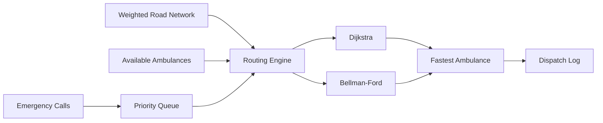

# 🚑 Ambulance Dispatch Routing System

A Python dispatch simulation that combines **priority queues, weighted graphs, shortest-path algorithms, automated testing, and performance benchmarking** to select the fastest available ambulance for emergency calls.

> **Portfolio project:** all road-network and emergency-call data in this repository is synthetic.

## What the application does

1. Loads a synthetic city road network from CSV.
2. Builds a weighted directed graph using travel time + traffic delay.
3. Prioritizes 100 emergency calls with a min-heap.
4. Calculates a route from each available ambulance to the emergency.
5. Selects the ambulance with the lowest estimated response time.
6. Logs the dispatch decision and route.
7. Benchmarks **Dijkstra vs. Bellman-Ford** across the same workload.



## Engineering concepts demonstrated

**Python • Data Structures • Graphs • Heaps • Dijkstra • Bellman-Ford • Modular Design • CSV Processing • Unit Testing • Benchmarking • GitHub Actions**

## Benchmark snapshot

The included benchmark uses the same synthetic workload for both algorithms: **7 locations, 42 directed road segments, 3 ambulances, and 100 emergency calls**, repeated for 10 runs.

| Algorithm | Average route-processing time* |
|---|---:|
| Dijkstra | 1.660 ms |
| Bellman-Ford | 3.460 ms |

In the captured run, **Dijkstra was 52.01% faster** for this positively weighted road network.

\*Runtime varies by hardware and Python environment. Raw results are available in [`results/benchmark_results.csv`](results/benchmark_results.csv).

## Run the simulation

Requires **Python 3.10+** and no third-party runtime dependencies.

```bash
# Dijkstra
python -m ambulance_dispatch --algorithm dijkstra

# Bellman-Ford
python -m ambulance_dispatch --algorithm bellman-ford
```

A dispatch log is written to the `results/` directory.

## Run the tests

```bash
python -m unittest discover -s tests -v
```

The repository includes tests for graph construction, call prioritization, shortest-path correctness, algorithm agreement, complete dispatch processing, and log generation.

## Reproduce the data and benchmark

```bash
# Regenerate the committed synthetic dataset
python scripts/generate_data.py

# Repeat the performance comparison
python scripts/benchmark.py --runs 10
```

## Project structure

```text
Ambulance-Dispatch-Routing-System/
├── ambulance_dispatch/       # Application modules
├── data/                     # Synthetic road, fleet, and call data
├── docs/                     # Architecture and design analysis
├── results/                  # Benchmark results and sample dispatch log
├── scripts/                 # Synthetic data generation + benchmark tools
├── tests/                    # Automated tests
├── .github/workflows/        # CI test workflow
├── pyproject.toml
└── README.md
```

## Design notes

- [`docs/architecture.md`](docs/architecture.md) — system flow and module responsibilities
- [`docs/design-decisions.md`](docs/design-decisions.md) — data structures and simulation assumptions
- [`docs/algorithm-analysis.md`](docs/algorithm-analysis.md) — why both routing algorithms were implemented and compared

## Key takeaway

This project demonstrates how **algorithm choice affects a larger software workflow**, not just an isolated coding exercise. Both algorithms produce valid shortest paths for the dataset, but Dijkstra is better aligned with a road network whose edge weights are always non-negative.
