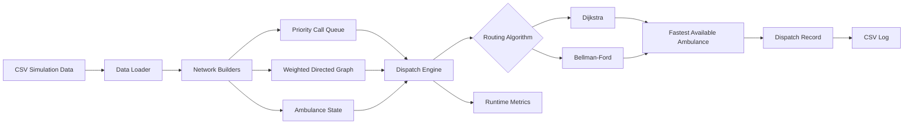

# System Architecture

The application separates data loading, structuring, ambulance routing protocols, dispatch processes, logging mechanisms, and benchmark testing into small Python modules. The design is intentionally lightweight so the data structures and algorithms remain easy to inspect.

## Data flow

1. CSV files provide the road network, ambulance staging locations, emergency calls, and call priorities.
2. The road network is converted to an adjacency-list graph. Each directed edge uses travel time plus traffic delay as its routing weight.
3. Emergency calls are inserted into a min-heap using `(priority, call_id)` so higher-acuity calls are processed first, and equal priorities remain deterministic.
4. For each call, the selected routing algorithm calculates a route from every available ambulance to the call location.
5. The ambulance with the lowest estimated travel time is dispatched.
6. A CSV record captures priority, ambulance selection, route, and travel time.
7. Route-processing time is accumulated for benchmarking.

## Simplifying assumptions

This is a software-engineering simulation, not an operational EMS system. Ambulances return to their staging location after each simulated response, traffic weights remain static during a run, and the data is synthetic.
